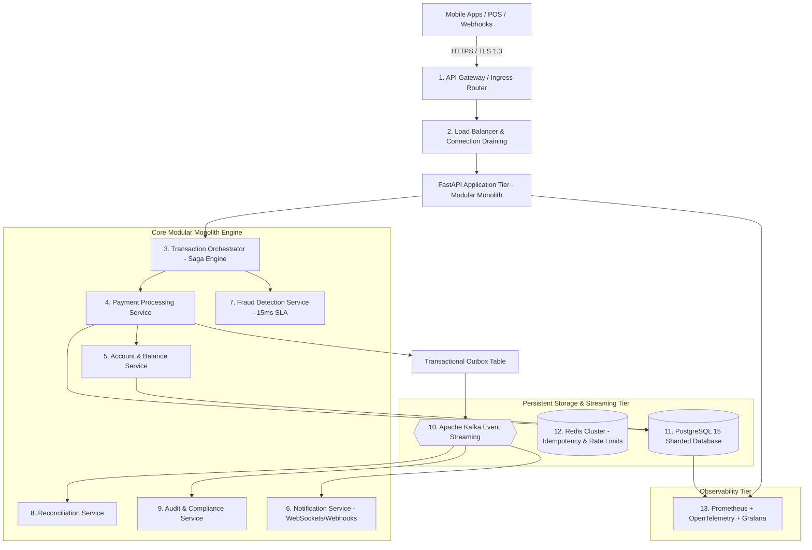

# Architecture Specification & Modular Monolith Design: PayScale HTTPE

## 1. System Vision & Architecture Strategy

PayScale Financial Technologies requires a high-throughput, fault-tolerant transaction processing backbone to scale from 1,200 TPS to 12,000+ sustained TPS and 18,000 burst TPS ahead of the Diwali festive campaign.

To avoid premature microservice network serialization overhead, cross-service distributed transaction locks, and operational complexity, PayScale HTTPE is implemented as a **High-Performance Modular Monolith in Python (FastAPI + AsyncIO + SQLAlchemy 2.x asyncpg)**. 

The modular monolith enforces strict domain boundaries:
* Core banking financial operations execute in local ACID database transactions.
* Service boundaries are kept clean and decoupled via domain events and service interfaces, allowing future extraction into standalone microservices if organizational scale demands it.
* Asynchronous workflows (notifications, fraud feature updates, settlement aggregation, and audit exports) execute via an asynchronous event bus and background worker pool.

---

## 2. High-Level Architecture (The 13 Subsystems)



---

## 3. The 13 Architecture Components

### 1. API Gateway Layer
* **Role:** Ingress termination, request validation, JWT authentication, and token-bucket rate limiting.
* **Implementation:** FastAPI middleware + Redis Lua script for distributed token buckets.
* **Failure Handling:** Enforces circuit breaking returning HTTP 503 with `Retry-After`.

### 2. Load Balancing Layer
* **Role:** Layer 7 traffic routing, health checks (`/health`), connection draining (90s graceful shutdown).
* **Implementation:** AWS ALB/NLB with AZ-affinity routing.

### 3. Transaction Orchestrator
* **Role:** Manages the distributed lifecycle of financial payments through deterministic state transitions:
  $$\text{INITIATED} \longrightarrow \text{PROCESSING} \longrightarrow \begin{cases} \text{COMPLETED} \\ \text{FAILED} \longrightarrow \text{REVERSED} \end{cases}$$
* **Implementation:** `app.services.saga_orchestrator.SagaOrchestrator`. Automatically executes compensating reversals within the 30-second RTO window upon partial failures.

### 4. Payment Processing Service
* **Role:** Validates balance sufficiency, applies business fee logic, generates cryptographic transaction hashes, inserts atomic debit and credit entries into `ledger_entries`, and writes to `outbox_events` within a single ACID transaction.
* **Implementation:** `app.services.payment_service.PaymentService`.

### 5. Account & Balance Management Service
* **Role:** Manages account profiles, status (ACTIVE, FROZEN, CLOSED), tier rate limits, and dual balances (`available_balance` and `ledger_balance`).
* **Implementation:** `app.services.account_service.AccountService`. Enforces Optimistic Concurrency Control (OCC) using atomic SQL Compare-And-Swap (CAS) updates:
  ```sql
  UPDATE accounts 
  SET available_balance = available_balance - :amount, version = version + 1
  WHERE account_id = :id AND version = :v AND available_balance >= :amount;
  ```

### 6. Notification Service
* **Role:** Dispatches real-time transaction receipts and settlement alerts via WebSockets and webhooks. Supports 50,000 concurrent client connections.
* **Implementation:** `app.services.notification_service.NotificationService` using non-blocking async event loops.

### 7. Fraud Detection Service
* **Role:** Real-time pre-authorization evaluation enforcing velocity limits (max 5 txns/60s), high-value thresholds (> ₹50,000 requires OTP), and geofence checks within a **strict 15 ms SLA**.
* **Implementation:** `app.services.fraud_service.FraudService` integrated with circuit breaker `CB-FRAUD`.

### 8. Reconciliation Service
* **Role:** Continuously audits double-entry ledger equations out-of-band:
  $$\sum \text{Debits} - \sum \text{Credits} = 0.0000$$
  Detects any drift between available and ledger balances and flags discrepancies.
* **Implementation:** `app.services.reconciliation_service.ReconciliationService`.

### 9. Audit & Compliance Service
* **Role:** Maintains an immutable, tamper-evident append-only log of every transaction state transition and customer KYC change. Masks sensitive PII (PAN and Aadhaar) per RBI regulations.
* **Implementation:** `app.services.audit_service.AuditService`.

### 10. Message Queue & Event Bus (Apache Kafka)
* **Role:** Asynchronous distributed streaming backbone. 32 partitions on `transaction-events` keyed by `account_id` for per-account FIFO ordering.
* **Implementation:** `app.events.kafka.KafkaProducerService` coupled with the Transactional Outbox pattern.

### 11. Database Layer (PostgreSQL 15 Sharded Cluster)
* **Role:** Persistent system of record guaranteeing ACID properties for accounts, transactions, and double-entry ledger journals.
* **Implementation:** 4 PostgreSQL shards partitioned by `hash(account_id) % 4` with PgBouncer connection pooling and Patroni automated failover (RTO < 30s, RPO = 0).

### 12. Cache Layer (Redis Cluster)
* **Role:** In-memory storage for 24-hour idempotency keys, rate limit token buckets, and hot account balances with jittered Cache-Aside TTLs.
* **Implementation:** `app.services.idempotency_service.IdempotencyService`.

### 13. Observability & Telemetry Stack
* **Role:** End-to-end distributed tracing (OpenTelemetry W3C TraceContext), metrics scraping (Prometheus), centralized logging, and dashboards (Grafana).
* **Implementation:** `app.observability.metrics` and `app.observability.logging`.

---

## 4. Financial Correctness Invariants

1. **Double-Entry Equilibrium:** Every payment generates equal debit and credit journal entries. The sum across the ledger strictly equals zero.
2. **Zero Overdrafts:** Balance cannot drop below zero. Enforced via database constraint `CHECK (available_balance >= 0)` and atomic CAS predicate `WHERE available_balance >= :amount`.
3. **Durable Idempotency:** Client-supplied UUIDv7 idempotency keys retained for 24 hours. Duplicate requests return stored outcomes with zero repeated financial effects; conflicting payloads return HTTP 409 Conflict.
4. **No Floating-Point Arithmetic:** All monetary amounts use fixed-precision `NUMERIC(18, 4)` and Python `Decimal`.
